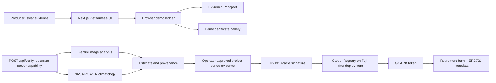

# AvaxGreen — Small rooftops. Bigger impact.

Vietnamese climate fintech hackathon MVP for Avalanche Team1 UniHack. Distinctive feature: **Evidence Passport**, showing provenance and the calculation behind each proposed carbon credit.

## Run

```bash
npm install
npm run dev
```

Open http://localhost:3000. No wallet, API key or AVAX is needed for the complete browser demo.

## 90-second judge walkthrough

1. Dashboard → **Trải nghiệm demo** to load the Thủ Đức sample.
2. **Xác minh nguồn năng lượng** → inspect Evidence Passport and explicit sample assumptions.
3. **Mint 394.6 GCARB** → demo balance increases.
4. **Tiếp tục mua & retire** → optionally buy credits at the demo rate.
5. Enter company name, retire 100 kg → certificate appears in the gallery.
6. Download certificate JSON. Reload: browser demo balance and certificates persist.

## What works, and what is simulated

| Component | Status |
|---|---|
| Responsive Vietnamese dashboard, original solar SVG illustration | Implemented |
| Upload preview, sample flow, calculator, mint, purchase, retirement, downloadable certificate | Browser simulation; localStorage persistence |
| EVM wallet address connection | Uses injected wallet; does not submit transactions |
| Solidity token and registry, tests, deployment scripts | Implemented; not deployed to Fuji |
| Gemini + NASA endpoint | Implemented in local Next server; requires API configuration; not used by hosted static demo |
| Oracle signing | Only approved image hashes/project periods; never automatically signs unreviewed AI estimates |
| Hosted static demo | Excludes server endpoint; contains no secrets |
| Live on-chain reads/writes and RainbowKit | Not connected in this version |
| Independently certified carbon credits | Not claimed; methodology and third-party verification required |

All dashboard historical values are illustrative. Purchases never transfer actual AVAX. A sample file name represents a bundled **scenario**, not an actual photograph. Uploaded images stay in the browser in the current UI.

## Architecture



## Contracts

- `GreenCarbonToken`: ERC20 + burnable, registry-only minting, one-time registry setup.
- `CarbonRegistry`: oracle signatures bound to chain ID, registry, recipient, amount and project-period proof. Global proof replay prevention; non-reentrant entry points.
- Marketplace transfers **previously verified treasury inventory** rather than issuing unbacked credits when AVAX is paid.
- Retirement requires approval, burns the holder's credits, and creates Base64 JSON/SVG metadata with exact 18-decimal kg, timestamp, company and ID.
- Company/reason metadata reject XML/JSON control characters. This is a restricted-text approach, not arbitrary rich text.
- Counters are in token base units (18 decimals). Total minted includes treasury inventory; purchases are transfers, not new issuance.

```bash
npm test
# In a read-only home environment:
XDG_CONFIG_HOME=/tmp/ag-config XDG_CACHE_HOME=/tmp/ag-cache XDG_DATA_HOME=/tmp/ag-data npm test
```

### Deployment

Copy `contracts/.env.example` to `contracts/.env`; use a dedicated funded Fuji test wallet. Set oracle signer address. From the root:

```bash
npm run deploy:fuji -w contracts
```

The script exports actual addresses and ABIs into `frontend/src/contracts/` and prints verification commands. No deployment address is fabricated here. Chain ID: **43113**. No mainnet deployments or real funds are required for the demonstration.

### Server oracle

Copy `frontend/.env.example` to `frontend/.env.local`. `POST /api/verify` accepts multipart fields `image`, `userAddress`, optional `latitude`, `longitude`, `capacity`.

The endpoint validates image MIME/magic/size, address, coordinates and capacity. It calls Gemini when configured, fetches NASA's annual climatological daily irradiance, and falls back with explicit source/mode labels. The calculation is a **30-day potential estimate**, not metered production. Solar irradiance does not prove generated electricity, installation ownership, additionality, or absence of off-chain double issuance.

A testnet signature is returned only when Gemini/NASA succeeded, detection confidence passes the threshold, and an operator approved the SHA256 image hash in `APPROVED_SOLAR_PROOFS` with a canonical project ID, period and cap. The same project-period proof is consumed once on-chain even across wallets. Production needs authenticated operators, a durable project-period registry, upload rate limits, metered generation and independent review before enabling public signing. Keys remain server-side.

## Build and hosting

```bash
npm run build
npm run export -w frontend
```

`build` includes the API route for Node hosting. `export` temporarily excludes the API, produces a static client in root `out/`, and restores the route even on failure. Static hosting runs the labeled browser demo only.

## Avalanche fit and next steps

Fuji provides EVM compatibility for the Solidity proof/mint/retire lifecycle. The project-period proof registry prevents reuse **inside this registry**, while external registry reconciliation is still required. A future Avalanche L1 could support permissioned verification operators, project registries and interoperable national ESG certificates. This is a roadmap, not a deployed capability.

Before presenting as a real on-chain MVP: fund and deploy Fuji contracts, authenticate and persist oracle approval records, connect UI reads/writes to exported ABIs, seed verified inventory, and demonstrate actual explorer receipts. Before production: independent audit, approved methodology, consent and evidence retention policies, calibrated performance and emissions factors, and an external double-issuance process.

## Technical references

- [NASA POWER climatology API](https://power.larc.nasa.gov/docs/services/api/temporal/climatology/)
- [Gemini generateContent](https://ai.google.dev/api/generate-content)
- [viem EIP-191 signing](https://viem.sh/docs/accounts/local/signMessage)
- [Avalanche developer documentation](https://build.avax.network/)

The 0.6766 kg CO₂/kWh factor and 21 kg CO₂/tree/year equivalent are illustrative assumptions from the brief, not verified current Vietnam regulatory factors.
